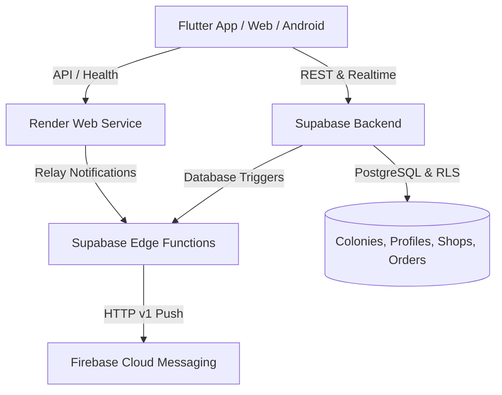

# The Local Shop (localshop) 🛒

A hyper-local colony ordering platform built for seniors, families, and neighborhood store owners. Designed with high-contrast, elder-friendly UI (58dp buttons, clear typography, intuitive flows) and zero product catalogs—customers connect directly with their verified colony shops.

---

## 🏛️ System Architecture



- **Frontend (`frontend/`)**: Flutter Web & Android APK with Riverpod 2.6 state management, GoRouter, high-contrast themes, multi-language support (English, Telugu, Hindi).
- **Backend Service (`backend/`)**: Node.js Express server configured for **Render** (`render.yaml`), providing health checks (`/health`), FCM relay, and colony validation.
- **Database & Auth (Supabase)**: Live PostgreSQL with Row-Level Security (RLS), Edge Functions (`fcm-sender`), and realtime message streaming.
- **Push Notifications (Firebase)**: Firebase Cloud Messaging (FCM) HTTP v1 API.

---

## 🚀 Deployment Guide

### 1. Backend on Render 🌐

The repository includes a ready-to-deploy `render.yaml` blueprint.

1. Create a free account at [Render](https://render.com).
2. Click **New +** → **Blueprint** (or **Web Service**).
3. Connect your GitHub repository: `https://github.com/siddarth1128/localshop.git`.
4. Render will automatically detect `render.yaml`:
   - **Root Directory**: `backend`
   - **Build Command**: `npm install`
   - **Start Command**: `npm start`
   - **Health Check Path**: `/health`
5. Ensure the following Environment Variables are configured:
   - `PORT`: `10000`
   - `SUPABASE_URL`: `https://cdqszwgemaxinfrzejuu.supabase.co`
   - `SUPABASE_ANON_KEY`: `<Your Supabase Anon Key>`
6. Click **Apply** / **Deploy**. Your backend will be live at `https://<your-service>.onrender.com`.

---

### 2. Frontend on Vercel ▲

The repository includes `vercel.json` configured for Flutter Web SPA routing.

#### Option A: Direct Import from GitHub
1. Sign in to [Vercel](https://vercel.com).
2. Click **Add New** → **Project**.
3. Import `siddarth1128/localshop`.
4. Configure Build & Development Settings:
   - **Framework Preset**: Other
   - **Root Directory**: `frontend`
   - **Output Directory**: `build/web`
5. Click **Deploy**.

---

## 📱 Demo & Test Accounts

- **Default Colony Join Code**: `GRN101` (Greenwood Heights Colony)

| Role | Phone | Name | Description |
| :--- | :--- | :--- | :--- |
| **Admin** | `+919000000000` | App Admin | Full administrative access |
| **Shop Owner** | `+919111111111` | Balaji Sharma | Sri Balaji Kirana & General Store |
| **Shop Owner** | `+919222222222` | Venkat Reddy | Vijaya Dairy & Fresh Sweets |
| **Shop Owner** | `+919333333333` | Ramesh Kumar | Fresh Veggies & Fruits Corner |
| **Customer** | `+919444444441` | Sita Devi | Resident (Flat A-102) |
| **Customer** | `+919444444442` | Srinivasa Rao | Resident (Flat B-304) |

*Default password for demo accounts:* `password123`

---

## 🛠️ Local Development

### Prerequisites
- Flutter SDK 3.24+
- Node.js 18+
- Supabase CLI

### Running Backend Locally
```bash
cd backend
npm install
npm start
# Server listens on http://localhost:3000
```

### Running Frontend Locally
```bash
cd frontend
flutter pub get
flutter run -d chrome # or android emulator
```

### Building Android APK
```bash
cd frontend
flutter build apk --release
# Generated APK: frontend/build/app/outputs/flutter-apk/app-release.apk
```
