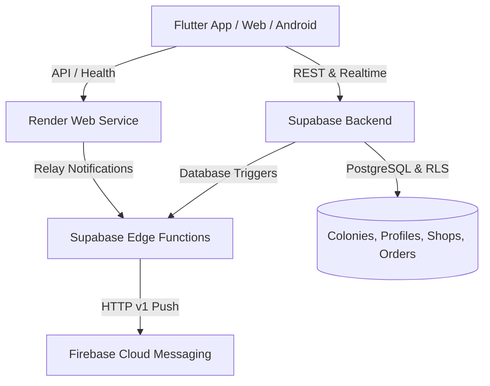

# The Local Shop (localshop) 🛒

A hyper-local colony ordering platform built for seniors, families, and neighborhood store owners. Designed with high-contrast, elder-friendly UI (58dp buttons, clear typography, intuitive flows) and zero product catalogs—customers connect directly with their verified colony shops.

---

## 🏛️ System Architecture



- **Frontend (`frontend/`)**: Flutter Web & Android APK with Riverpod 2.6 state management, GoRouter, high-contrast themes, multi-language support (English, Telugu, Hindi).
- **Backend Service (`backend/`)**: Node.js Express server configured for **Render** (`render.yaml`), providing health checks (`/health`), FCM relay, and colony validation.
- **Database & Auth (Supabase)**: Live PostgreSQL with Row-Level Security (RLS), Edge Functions (`fcm-sender`), and realtime message streaming.
- **Push Notifications (Firebase)**: Firebase Cloud Messaging (FCM) HTTP v1 API.

---

## 🚀 Deployment Guide

### 1. Backend on Render 🌐

The repository includes a ready-to-deploy `render.yaml` blueprint.

1. Create a free account at [Render](https://render.com).
2. Click **New +** → **Blueprint** (or **Web Service**).
3. Connect your GitHub repository: `https://github.com/siddarth1128/localshop.git`.
4. Render will automatically detect `render.yaml`:
   - **Root Directory**: `backend`
   - **Build Command**: `npm install`
   - **Start Command**: `npm start`
   - **Health Check Path**: `/health`
5. Ensure the following Environment Variables are configured:
   - `PORT`: `10000`
   - `SUPABASE_URL`: `https://cdqszwgemaxinfrzejuu.supabase.co`
   - `SUPABASE_ANON_KEY`: `<Your Supabase Anon Key>`
6. Click **Apply** / **Deploy**. Your backend will be live at `https://<your-service>.onrender.com`.

---

### 2. Frontend on Vercel ▲

The repository includes `vercel.json` configured for Flutter Web SPA routing.

#### Option A: Direct Import from GitHub
1. Sign in to [Vercel](https://vercel.com).
2. Click **Add New** → **Project**.
3. Import `siddarth1128/localshop`.
4. Configure Build & Development Settings:
   - **Framework Preset**: Other
   - **Root Directory**: `frontend`
   - **Output Directory**: `build/web`
5. Click **Deploy**.

---

## 📱 Demo & Test Accounts

- **Default Colony Join Code**: `GRN101` (Greenwood Heights Colony)

| Role | Phone | Name | Description |
| :--- | :--- | :--- | :--- |
| **Admin** | `+919000000000` | App Admin | Full administrative access |
| **Shop Owner** | `+919111111111` | Balaji Sharma | Sri Balaji Kirana & General Store |
| **Shop Owner** | `+919222222222` | Venkat Reddy | Vijaya Dairy & Fresh Sweets |
| **Shop Owner** | `+919333333333` | Ramesh Kumar | Fresh Veggies & Fruits Corner |
| **Customer** | `+919444444441` | Sita Devi | Resident (Flat A-102) |
| **Customer** | `+919444444442` | Srinivasa Rao | Resident (Flat B-304) |

*Default password for demo accounts:* `password123`

---

## 🛠️ Local Development

### Prerequisites
- Flutter SDK 3.24+
- Node.js 18+
- Supabase CLI

### Running Backend Locally
```bash
cd backend
npm install
npm start
# Server listens on http://localhost:3000
```

### Running Frontend Locally
```bash
cd frontend
flutter pub get
flutter run -d chrome # or android emulator
```

### Building Android APK
```bash
cd frontend
flutter build apk --release
# Generated APK: frontend/build/app/outputs/flutter-apk/app-release.apk
```

---

## 🎨 Glassmorphic Design System

"The Local Shop" features a presentation architecture crafted with an adaptive, GPU-accelerated glassmorphism design system, ambient aurora lighting, and a 4-act cinematic motion splash.

### 1. Design Tokens (`lib/core/theme/app_tokens.dart`)

- **Color Palettes**:
  - **Dark Mode**: Background `#0A0F1C` → `#101828`, Emerald `#34D399` (Primary), Amber `#FBBF24` (Accent), Aurora Blobs (Emerald @25%, Indigo @20%, Amber @12%).
  - **Light Mode**: Background `#EEF3F8` → `#F8FAFC`, Calibrated Emerald `#059669` (AA Contrast), Soft Mint/Peach/Sky Blobs @35%.
  - **Rule**: Maximum 1 primary + 1 accent per screen; all other layers use neutral glass fills (`rgba(255,255,255,0.08)` dark, `rgba(255,255,255,0.55)` light) with top-edge specular highlights (`rgba(255,255,255,0.28)`).
- **Typography**:
  - Headings: `GoogleFonts.sora` (SemiBold 600 / Bold 700).
  - Body & Labels: `GoogleFonts.plusJakartaSans` (Regular 400 / Medium 500 / SemiBold 600).
  - Sizes: Scale `12 / 14 / 16 / 20 / 24 / 32`.
- **Radii & Geometry**:
  - Cards: `24dp`
  - Buttons & Inputs: `16dp`
  - Bottom Sheets: `32dp`
  - Chips & Pills: `999dp`
- **Spacing Scale**: `4 / 8 / 12 / 16 / 20 / 24 / 32dp`.

### 2. Glass Component Library (`lib/core/widgets/glass/`)

| Component | Description | Performance Optimization |
| :--- | :--- | :--- |
| `GlassScaffold` | Animated ambient drifting aurora background blobs | Hardware-accelerated CustomPainter, paused when backgrounded |
| `GlassCard` | Glass container with top gleam highlight & gradient border | Cached `ImageFilter`, `useRealBlur: false` ("fake glass") for 60fps lists |
| `GlassButton` | Filled primary and outline secondary with haptics & press scale | `AnimatedScale(0.97)` + spring curve, built-in spinner morph |
| `GlassTextField` | Floating label with primary glow and error shake | Pure Matrix4 horizontal oscillation curve on validation error |
| `GlassBottomNav` | Floating frosted pill with active icon morph & label fade | Single `BackdropFilter` layer with haptic feedback on tab change |
| `GlassAppBar` | Translucent blurred top navigation bar | Preserves safe-area padding with `NavigationToolbar` |
| `GlassChip` | Filter and delivery slot selection pill | Instant (+₹10), Morning 7 AM (+₹5), Evening 6 PM (+₹5) glow |
| `GlassBottomSheet`| Draggable blurred modal sheet | Drag handle, frosted gradient, keyboard-avoiding constraints |
| `GlassDialog` | Central confirmation and alert modal | Cached blur with responsive dialog bounds |
| `GlassSnackbar` | Floating glass pill for notifications | Danger, Success, and Info tints with WCAG AA compliance |
| `GlassSkeleton` | Shimmer placeholder loader | Pure Flutter shader sweep without external heavy libraries |
| `GlassPerformance`| Adaptive performance probe | Selects Low (`sigma 8`), Medium (`sigma 14`), or High tier (`sigma 18`) |

### 3. Motion System & Cinematic Splash (`lib/features/splash/`)

- **Durations**: Micro (`120ms`), Small (`200ms`), Medium (`320ms`), Large (`500ms`), Hero (`900ms`), Splash (`3200ms`).
- **Curves**: Enter (`easeOutCubic`), Exit (`easeInCubic`), Pop (`easeOutBack`), Press (`Cubic(0.34, 1.56, 0.64, 1.0)`).
- **Cinematic Story (Pure Flutter CustomPainter + 3D Perspective Matrix)**:
  1. **Act 1 (0.0s – 0.8s)**: 3D perspective-tilted phone mockup appears (`setEntry(3, 2, 0.001)`), order card renders, and thumb ripple confirms order.
  2. **Act 2 (0.8s – 1.7s)**: Glowing glass order chip detaches and glides along a cubic Bezier curve to the neighborhood colony shop.
  3. **Act 3 (1.7s – 2.7s)**: Flat vector scooter travels across a road with 3 parallax scenery depth layers to customer doorstep with bounce.
  4. **Act 4 (2.7s – 3.2s)**: Camera zooms back with logo reveal, specular shimmer sweep, and hero transition into the application.
  - Abbreviated 1s version on subsequent launches; respects `MediaQuery.disableAnimations`.

